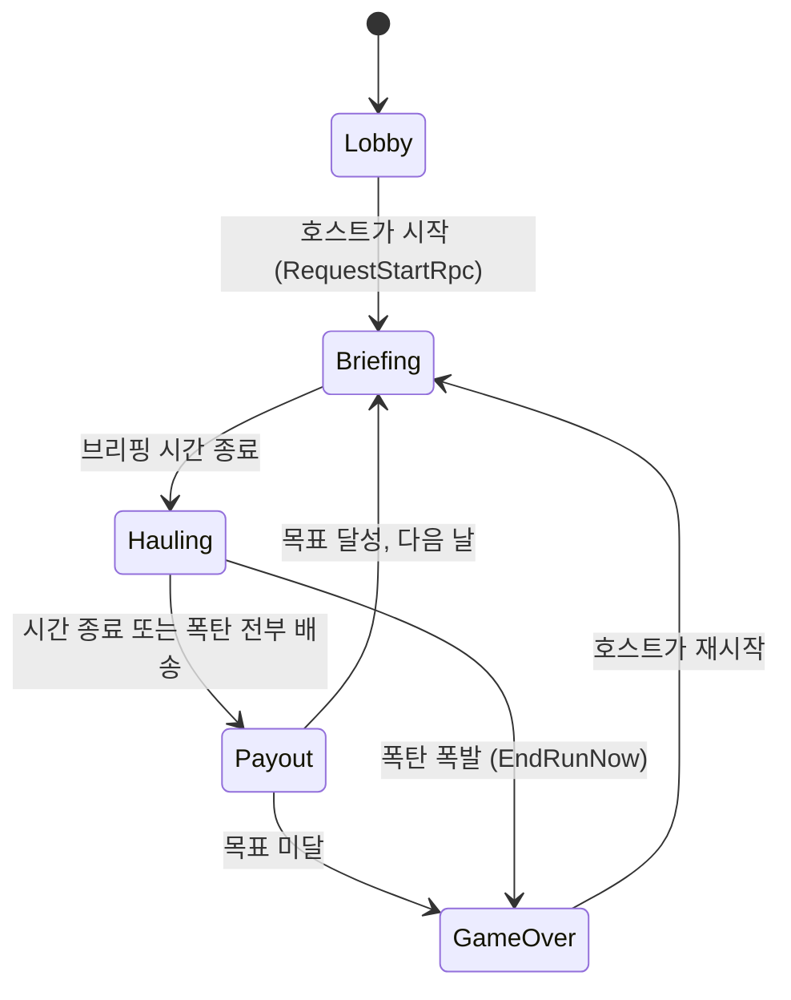
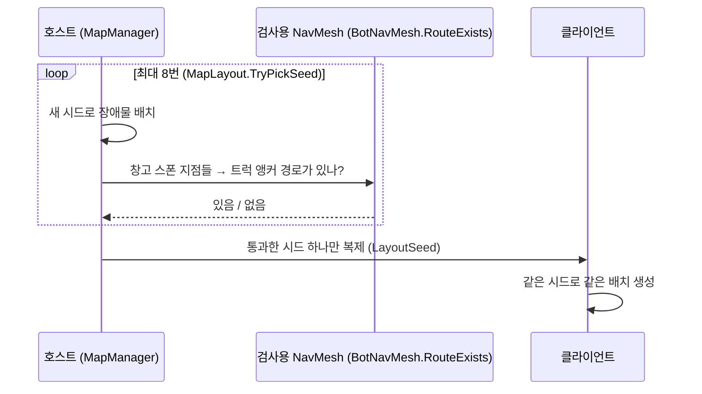
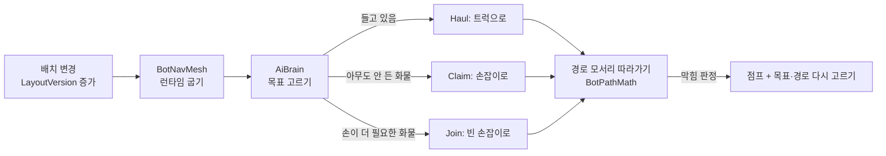

# 구조 설명 — Handle With Care

이 문서는 코드를 처음 읽는 사람을 위한 안내입니다. 누가 무엇을 결정하는지(권한 모델), 한 판이 어떻게 흘러가는지, 무작위 배치가 막히지 않게 하는 방법, 봇이 길을 찾는 방법, 그리고 직접 잰 수치와 알려진 한계를 차례로 설명합니다. 게임 소개와 조작법은 [`README.md`](README.md)에 있습니다.

## 1. 한눈에 보기

- 엔진: Unity 6.5 (6000.5.7f1), URP 17.5, Netcode for GameObjects(NGO) 2.13, Input System 1.20, uGUI
- 씬은 [`Assets/SlopCo/Scenes/Bootstrap.unity`](Assets/SlopCo/Scenes/Bootstrap.unity) 하나입니다. 타이틀·로비·맵 네 개(디포·야드·항구·옥상)·HUD가 모두 이 씬 안에 있고, 맵은 켜고 끄며 바꿉니다.
- 게임 코드는 런타임 어셈블리 하나(`SlopCo`), 테스트는 EditMode 어셈블리 하나(`SlopCo.Tests.EditMode`)입니다.

| 폴더 (`Assets/SlopCo/Scripts/`) | 하는 일 |
|---|---|
| `Core/` | 상수, 설정, 서비스 로케이터, 현지화, 스폰 등록 목록(`LiveSet`) |
| `Networking/` | 세션 시작·참가(`LocalNetworkSession`), 접속 승인과 참가 정책(`JoinPolicy`), LAN 빠른 매칭 |
| `Gameplay/` | 라운드 상태 기계(`RoundManager`), 맵·장애물 배치(`MapManager`, `MapLayout`), 맵별 장애물 목록(`ObstacleSet`), 위험 요소, 할당량, 이탈 투표 |
| `Cargo/` | 서버가 시뮬레이션하는 화물(`CargoItem`), 퓨즈(`CargoCondition`), 폭탄(`CargoBomb`), 함께 들기 계산 |
| `Player/` | 이동, 잡기·던지기, 발차기, 봇 AI(`AiBrain`), 봇 NavMesh(`BotNavMesh`), 경로 추종 규칙(`BotPathMath`) |
| `Items/`, `Audio/`, `UI/` | 아이템, 근접 보이스 챗, HUD·메뉴·디버그 오버레이 |

## 2. 권한 모델: 누가 무엇을 결정하나

호스트가 서버 역할을 겸합니다(listen server). 결정 권한은 한 곳에 몰지 않고, 반응성이 중요한 것과 공정해야 하는 것을 나눴습니다.

| 대상 | 결정하는 쪽 | 다른 플레이어에게 전달되는 방법 | 코드 |
|---|---|---|---|
| 플레이어 이동·대시·넉백 | 그 캐릭터의 소유 클라이언트 | `ClientNetworkTransform`(소유자 권위 NetworkTransform) | [`PlayerController.cs`](Assets/SlopCo/Scripts/Player/PlayerController.cs), [`ClientNetworkTransform.cs`](Assets/SlopCo/Scripts/Player/ClientNetworkTransform.cs) |
| 화물 물리·충돌 피해·폭발 | 서버 | `NetworkRigidbody` + 서버 권위 NetworkTransform, 퓨즈는 `NetworkVariable` | [`CargoItem.cs`](Assets/SlopCo/Scripts/Cargo/CargoItem.cs), [`CargoCondition.cs`](Assets/SlopCo/Scripts/Cargo/CargoCondition.cs), [`CargoBomb.cs`](Assets/SlopCo/Scripts/Cargo/CargoBomb.cs) |
| 잡기·던지기·발차기·아이템·핑·음성 | 소유자가 요청하고 서버가 판정 | 서버 RPC. 소유자만 부를 수 있음(`InvokePermission = Owner`) | [`PlayerCarryController.cs`](Assets/SlopCo/Scripts/Player/PlayerCarryController.cs), [`PlayerInventory.cs`](Assets/SlopCo/Scripts/Items/PlayerInventory.cs), [`KickAbility.cs`](Assets/SlopCo/Scripts/Player/KickAbility.cs) |
| 라운드 진행·정산 | 서버 | `NetworkVariable`(단계, 남은 시간, 날짜). 시작 RPC는 호스트만(`InvokePermission = Server`) | [`RoundManager.cs`](Assets/SlopCo/Scripts/Gameplay/RoundManager.cs) |
| 맵·장애물 배치 | 서버가 시드를 고름 | 시드 정수 하나(`LayoutSeed`)만 복제, 각자 같은 시드로 같은 배치를 생성 | [`MapManager.cs`](Assets/SlopCo/Scripts/Gameplay/MapManager.cs), [`MapLayout.cs`](Assets/SlopCo/Scripts/Gameplay/MapLayout.cs) |
| 봇 | 호스트(봇의 소유자) | 사람과 같은 `ClientNetworkTransform` | [`AiBrain.cs`](Assets/SlopCo/Scripts/Player/AiBrain.cs) |
| 누가 들어올 수 있나 | 호스트 | NGO 접속 승인. 거절 사유는 현지화 키로 보냄 | [`ConnectionApprovalHandler.cs`](Assets/SlopCo/Scripts/Networking/ConnectionApprovalHandler.cs), [`JoinPolicy.cs`](Assets/SlopCo/Scripts/Networking/JoinPolicy.cs) |

### 서버 RPC 호출 권한

NGO 2.x의 `[Rpc(SendTo.Server)]`는 기본값이 "누구나 호출 가능"입니다. 그대로 두면 클라이언트가 남의 캐릭터 이름으로 잡기·던지기를 보낼 수 있습니다. 그래서 플레이어 오브젝트에 달린 서버 RPC 11개에는 `InvokePermission = RpcInvokePermission.Owner`를, 라운드 시작 RPC에는 `RpcInvokePermission.Server`를 붙였습니다. 권한 없는 호출은 보내는 쪽에서 예외가 나고, 받는 쪽에서는 버려집니다.

[`RpcPermissionTests.cs`](Assets/SlopCo/Tests/EditMode/RpcPermissionTests.cs)는 플레이어 프리팹의 컴포넌트 다섯 종(잡기, 인벤토리, 발차기, 핑, 음성)에서 서버행 RPC를 리플렉션으로 모두 찾아 권한을 확인합니다. 이 컴포넌트에 RPC를 추가하면서 권한을 빠뜨리면 테스트가 실패합니다. 라운드 시작 RPC의 호스트 전용 권한도 같은 파일에서 확인합니다.

## 3. 한 판의 흐름



- 상태는 서버만 바꾸고(`SetPhase`), 클라이언트는 `NetworkVariable`로 받아 화면만 바꿉니다. 맵과 장애물 배치는 새 판을 시작할 때(`StartGame`) 한 번 정합니다.
- 운반(Hauling) 중에는 새 참가를 받지 않습니다. 폭탄 수와 함께 들기 무게가 그 운반을 시작한 인원에 맞춰 정해졌기 때문입니다. 브리핑과 정산 중에는 들어올 수 있습니다. LAN 광고(`HostBeacon`)도 같은 규칙(`JoinPolicy.ShouldAdvertise`)을 써서, 빠른 매칭이 거절될 방으로 안내하지 않습니다.
- 진행 중인 판에서 누군가 나가면 서버가 게임을 멈추고, 남은 사람들이 계속할지 끝낼지 투표합니다. 동률이거나 아무도 답하지 않으면 계속합니다. 끝내기로 하면 폭탄 폭발과 같은 `EndRunNow`로 판을 끝냅니다. 어떤 이탈이 투표 대상인지는 [`DisconnectRules.cs`](Assets/SlopCo/Scripts/Gameplay/DisconnectRules.cs)가 정합니다.

## 4. 절차적 배치가 길을 막지 않게 하기

### 문제

맵마다 장애물을 시드에 따라 무작위로 놓습니다. 디포·야드는 기본 도형 4종(상자·통·고깔·낮은 바리케이드), 항구·옥상은 맵별 장애물 목록(`ObstacleSet`)의 소품을 씁니다. 바닥 크기는 기본 도형이 기본 배율에서, 목록 소품은 가장 크게 굴려도 1.1m 이하이고, 어느 쪽이든 단단한 콜라이더를 가집니다. 직접 플레이해 보니, 높은 도크 맵에서 장애물 두 개가 고가 통로의 유일한 길을 막는 배치가 있었습니다. 틈이 0.775m로 캐릭터 폭 0.8m보다 좁았고, 봇 세 명이 도크 아래에서 점프만 반복하다 폭탄이 터졌습니다. 사람도 지나가기 어려운 배치입니다(장애물 높이 0.87~1.13m, 점프 정점 0.69m).

호스트와 같은 설정으로 NavMesh를 구워 무작위 시드 500개를 검사하니 **61개(12.2%)**가 창고에서 트럭까지 갈 수 없었습니다.

### 해결: 시드를 확정하기 전에 검사



- 클라이언트 코드는 바꾸지 않았습니다. 클라이언트가 받는 것은 여전히 시드 정수 하나입니다.
- 검사용 NavMesh는 `NavMesh.CreateSettings()`로 만든 **별도 에이전트 타입**으로 굽고, 질의할 때도 그 타입으로 거릅니다. 그래서 봇이 실제로 쓰는 NavMesh는 검사 중에도 건드리지 않습니다.
- `NavMesh.SamplePosition`은 목표 지점이 메시 밖이면 가장 가까운 메시로 조용히 옮겨 줍니다. 그러면 도크 위 대신 도크 옆 바닥까지의 경로가 "있음"으로 나옵니다. 그래서 옮겨진 거리가 수평 0.8m, 수직 1.2m 안일 때만 같은 지점으로 칩니다(`BotPathMath.IsOnPoint`).
- 시드 고르기 규칙(`MapLayout.TryPickSeed`)은 엔진과 무관한 순수 함수라 따로 테스트합니다. 8번 모두 실패하면 경고 로그를 남기고 마지막 시드를 씁니다.

### 결과 (에디터에서 측정)

| 항목 | 값 |
|---|---|
| 검사 전, 높은 도크 시드 500개 | 61개 막힘 (12.2%) |
| 검사 후, 디포·야드(측정 당시 맵 두 개) × `RollMap` 300번, 봇과 같은 설정으로 따로 다시 구워 확인 | 막힘 0번 |
| 시드를 다시 뽑은 판 | 맵 0: 300번 중 4번, 맵 1: 300번 중 6번 |
| `RollMap` 한 번 걸린 시간 | 평균 6.5ms, 최대 14ms (새 판을 시작할 때 호스트에서 한 번) |

막혔던 실제 시드(맵 0, 1428223278)는 [`BotNavMeshTests.cs`](Assets/SlopCo/Tests/EditMode/BotNavMeshTests.cs)의 `ObstacleField_RouteCheck_MatchesPlay`가 실제 맵 배치를 만들어 그대로 재현합니다.

나중에 더한 항구·옥상은 같은 파일의 `LayoutRoll_FindsADeliverableSeed`가 호스트와 같은 시드 고르기를 고정 시드 흐름으로 10번 돌려 지킵니다. 검사 없이 첫 시드만 본 막힘 수는 시드 1~300에서 항구 3개(1%), 옥상 0개였습니다.

## 5. 봇 길찾기



- **NavMesh 굽기**: 맵 배치가 바뀌면(`MapManager.LayoutVersion`) 배치가 자리 잡은 뒤 한 번 다시 굽습니다. 재료는 움직이지 않는 단단한 콜라이더뿐입니다. 트리거, 리지드바디가 있는 화물, 캐릭터는 뺍니다(`BotPathMath.IsBakeSource`). Unity 내장 `NavMeshBuilder`를 써서 씬에 미리 구운 데이터가 필요 없습니다.
- **목표 고르기**: 들고 있으면 트럭으로, 아니면 아무도 안 든 화물, 그다음 손이 더 필요한 화물 순입니다. 두 봇이 같은 손잡이로 몰리지 않게 비어 있는 손잡이를 고릅니다.
- **경로 다시 계산**: NavMesh가 다시 구워졌거나, 목표가 수평으로 일정 거리 이상 움직였거나, 일정 시간이 지나면 다시 계산합니다(`BotPathMath.NeedsReplan`). 들어 올린 화물처럼 목표가 위아래로만 움직인 경우는 다시 계산하지 않습니다.
- **막힘 판정**: "요청한 속도의 25%도 못 움직인 시간"을 쌓아서 판정합니다(`BotPathMath.StepStallClock`). 처음에는 프레임당 이동 거리를 고정값과 비교했는데, 144fps 호스트에서는 정상적으로 무거운 짐을 나르는 봇도 막힌 것으로 판정되어 계속 점프했습니다. 지금은 30·60·144·240fps에서 같은 결과가 나오는 것을 테스트로 고정했습니다.

## 6. 성능: 매 프레임 씬 검색 없애기

HUD 퓨즈 게이지는 매 프레임 모든 클라이언트에서, 쥐는 쥐마다 매 프레임 호스트에서 `FindObjectsByType`로 씬 전체를 뒤졌습니다. 봇도 0.5초마다 화물을 찾으려고 같은 일을 했습니다. 이 함수는 부를 때마다 새 배열을 만들고 씬의 모든 오브젝트를 훑습니다.

이제는 각 컴포넌트가 스폰될 때 등록하고 디스폰될 때 빠지는 목록([`LiveSet.cs`](Assets/SlopCo/Scripts/Core/LiveSet.cs))을 읽습니다. `CargoBomb`, `CargoItem`, `PlayerCarryController`가 스폰·디스폰 때, `AiBrain`이 켜지고 꺼질 때 등록합니다. 도메인 리로드 없이 Play에 들어가도 지난 세션의 항목이 남지 않도록 `SubsystemRegistration` 시점에 비웁니다.

| 같은 일을 1,000번 반복 (에디터 Play, 씬 Transform 약 180개) | 1회 시간 |
|---|---|
| 이전: `FindObjectsByType` 세 번 + `GetComponent` | 133µs |
| 이후: 등록 목록 세 개 순회 | 0.2µs |

할당량은 에디터의 Mono에서 정확히 잴 방법이 없어서(대조군도 0으로 나옴) 표에 넣지 않았습니다.

## 7. 개발용 디버그 오버레이 (F3)

[`DebugOverlay.cs`](Assets/SlopCo/Scripts/UI/DebugOverlay.cs)는 `UNITY_EDITOR || DEVELOPMENT_BUILD`일 때만 컴파일되고, 시작할 때 스스로 만들어지므로 씬을 고칠 필요가 없습니다. F3으로 켜고 끕니다.

| 줄 | 내용 |
|---|---|
| FRAME | FPS, 평균·최악 프레임 시간, 프레임당 GC 할당(`ProfilerRecorder`), 관리 힙 크기. 에디터에서는 에디터 자체 할당이 섞입니다 |
| NET | 호스트/클라이언트, 틱레이트, 스폰된 오브젝트 수, 클라이언트별 RTT(`UnityTransport.GetCurrentRtt`) |
| RUN / MAP / NAV / BOMB | 라운드 단계·날짜·남은 시간·인원, 맵과 레이아웃 시드, 호스트가 버린 시드 수, NavMesh 굽기 횟수, 가장 짧은 퓨즈 |
| BOTS | 봇마다 판단 상태(Haul/Claim/Join/Idle), 경로 진행(남은 모서리), 막힘 시간, 점프 횟수 |

게임 화면에는 봇의 남은 경로를 판단 상태별 색 선으로 그리고 머리 위에 같은 내용을 띄웁니다. Scene 뷰에서 봇을 선택하면 경로와 목표가 기즈모로 보입니다. 수치를 모으는 `FrameStats`는 고정 크기 링 버퍼라 측정 자체가 GC를 만들지 않고, 글자는 초당 4번만 다시 만듭니다.

## 8. 테스트

EditMode 테스트 508개가 [`Assets/SlopCo/Tests/EditMode/`](Assets/SlopCo/Tests/EditMode)에 있습니다. 대부분은 엔진과 무관한 순수 규칙(할당량, 함께 들기 무게, 데일리 모디파이어, 참가 정책, 이탈 투표 집계 등)이고, 다음은 실제 엔진 기능을 씁니다.

| 테스트 | 확인하는 것 |
|---|---|
| [`BotNavMeshTests.cs`](Assets/SlopCo/Tests/EditMode/BotNavMeshTests.cs) | 상자를 놓고 실제로 NavMesh를 구워, 틈이 열리면 경로 있음·닫히면 없음, 도크 위 목표를 옆 바닥으로 착각하지 않음, 검사가 봇의 NavMesh를 건드리지 않음, 플레이에서 막혔던 시드 재현, 맵 네 개의 운반 경로, 항구·옥상 시드 굴림과 다리 외 우회로 없음 |
| [`ObstacleSetTests.cs`](Assets/SlopCo/Tests/EditMode/ObstacleSetTests.cs) | 항구·옥상 장애물 목록의 소품 구성, 바닥 크기 1.1m 규칙, 단단한 콜라이더(리지드바디 없음), 슬롯 위에 서는 배치 |
| [`MapLayoutTests.cs`](Assets/SlopCo/Tests/EditMode/MapLayoutTests.cs) | 시드 고르기 규칙, 배치 결정론 |
| [`BotPathMathTests.cs`](Assets/SlopCo/Tests/EditMode/BotPathMathTests.cs) | 경로 모서리 진행, 재계산 조건, 프레임레이트와 무관한 막힘 판정, 봇 판단 상태 분류 |
| [`RpcPermissionTests.cs`](Assets/SlopCo/Tests/EditMode/RpcPermissionTests.cs) | 서버행 RPC의 호출 권한 |
| [`LiveSetTests.cs`](Assets/SlopCo/Tests/EditMode/LiveSetTests.cs), [`DebugOverlayTextTests.cs`](Assets/SlopCo/Tests/EditMode/DebugOverlayTextTests.cs) | 등록 목록, 오버레이 수치·문구 |

실행 방법:

1. 에디터에서: **Window → General → Test Runner → EditMode → Run All**
2. 명령줄에서(에디터를 닫은 상태):

   ```
   Unity.exe -batchmode -projectPath <프로젝트 경로> -runTests -testPlatform EditMode -testResults TestResults.xml
   ```

## 9. 알려진 한계

- **플레이어 이동은 클라이언트를 믿습니다.** 서버가 위치를 다시 검증하지 않아 위치 조작을 막지 못합니다. 친구끼리 하는 협동 게임이라 입력 지연이 없는 쪽을 골랐습니다. 점수와 라운드 단계는 서버만 바꿀 수 있지만, 위치를 속이면 운반 결과에는 영향을 줄 수 있습니다.
- **호스트가 나가면 세션이 끝납니다.** 호스트 이전은 없습니다.
- **접속은 같은 네트워크 또는 IP 직접 접속뿐입니다.** 릴레이와 NAT 통과가 없고, 포트는 7777로 고정입니다. Steam 연동은 인터페이스와 구현 안내([`SteamNetworkSession.cs`](Assets/SlopCo/Scripts/Networking/SteamNetworkSession.cs))만 있습니다.
- **Play 중 스크립트를 고치면 세션이 깨집니다.** NGO 세션은 도메인 리로드를 견디지 못하고, 열려 있던 UDP 소켓이 에디터를 다시 켤 때까지 남아 다음 호스트 시작이 실패할 수 있습니다. **Preferences → General → Script Changes While Playing**을 **Recompile After Finished Playing**으로 두는 것을 권합니다.
- **자동 테스트는 EditMode뿐입니다.** 여러 NetworkManager를 띄우는 통합 테스트는 정적 상태(`ServiceLocator` 등)와 충돌해서 아직 없습니다. 네트워크 동작은 에디터 Play로 확인합니다.
- **런타임 코드는 어셈블리 하나입니다.** 폴더로는 나뉘어 있지만 어셈블리 경계로 의존 방향을 강제하지는 않습니다.
